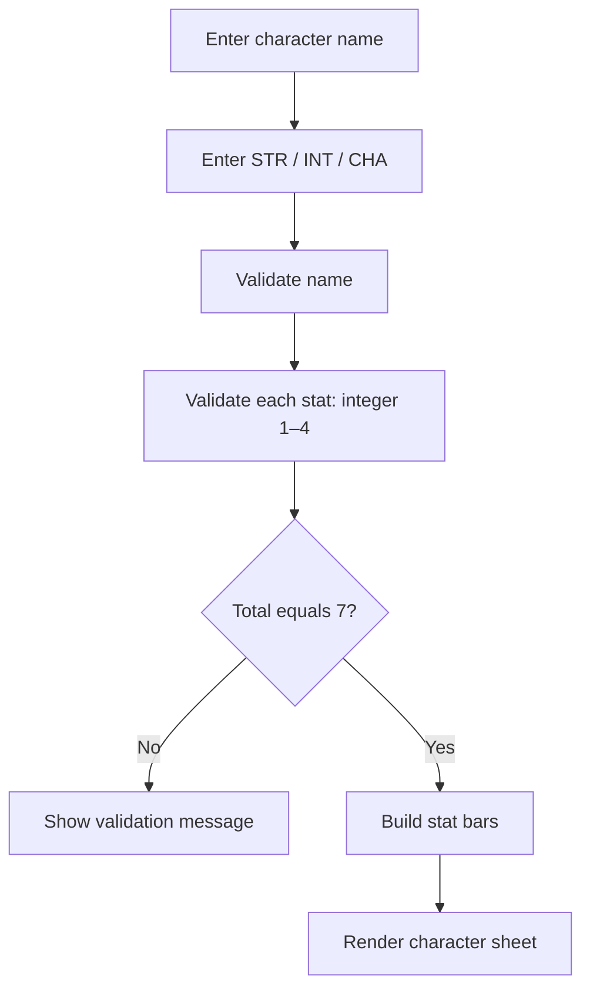

# RPG Character Validator & Sheet Generator

A Python utility for validating a tabletop RPG character and generating a compact stat sheet. This repository now includes a browser-based companion that follows the same validation rules.


## Live interface

After enabling **Settings → Pages → Build and deployment → GitHub Actions**, visit:

[Open the character generator](https://aKmsdfhjb.github.io/python-rpg_character-generator/)

## Rules

- Character name must be a non-empty string, no more than 10 characters, with no spaces.
- Strength, Intelligence and Charisma must each be integers from 1 to 4.
- The three attributes must total exactly 7 points.
- A successful character sheet renders ten-slot visual stat bars.

## Flow



## Run locally

Python:

```bash
python main.py
```

Import the reusable function:

```python
from main import create_character

print(create_character("Ren", 4, 2, 1))
```

Browser interface: open `index.html` in a modern browser.

## Project structure

- `main.py` — validation and character-sheet generation.
- `index.html` — interactive browser companion.
- `.github/workflows/pages.yml` — GitHub Pages deployment.

## Documentation and Wiki

The README is the quick-start guide. Keep longer design notes in `docs/`. To use GitHub's separate Wiki tab, enable Wikis in repository settings and create the Wiki pages there.

## License

MIT — see [LICENSE](LICENSE).


## Project Wiki

- [Wiki home](docs/wiki/Home.md)
- [Architecture and deployment](docs/wiki/Architecture.md)

The repository keeps a version-controlled wiki source under `docs/wiki/`.
- [Video production brief](docs/video/production-brief.md)