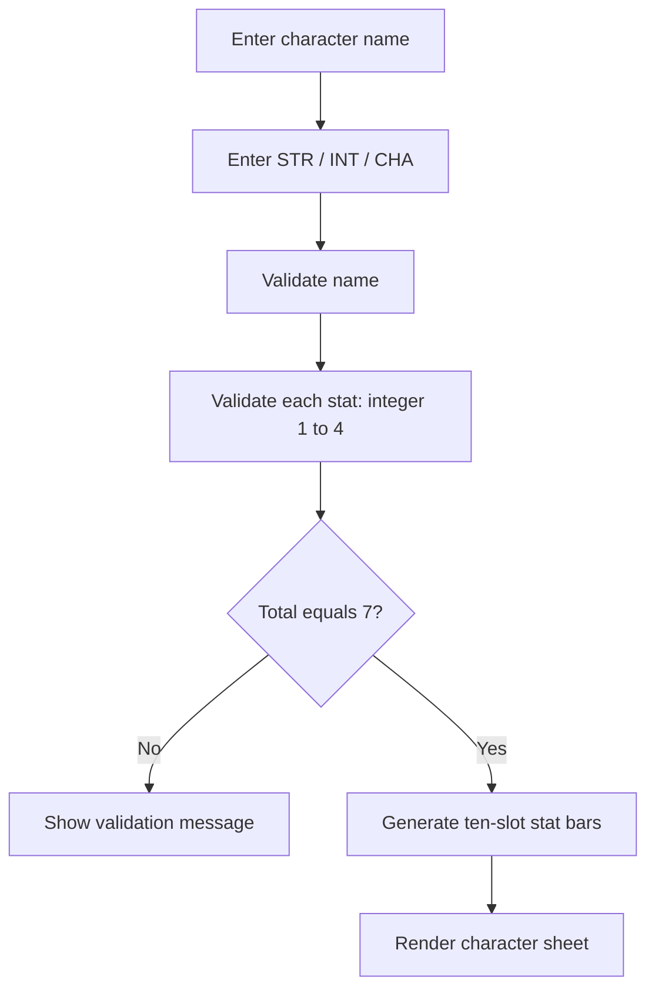

# RPG Character Generator — Architecture

## System flow

## Design notes

- Keep user-interface responsibilities separate from model, API and data-service responsibilities.
- Validate inputs at the application boundary and return clear error messages.
- Keep secrets and privileged credentials on the server side.
- Document the versions of data, dependencies and model artifacts used for reproducible results.
- Test the full user journey after deployment, not only the build step.

## Deployment boundary

GitHub Pages can host static HTML, CSS, JavaScript and prebuilt frontend assets. It cannot execute Python/Flask services, server-side React Router actions, private environment variables or database operations. Those parts require a separate backend or application host.
